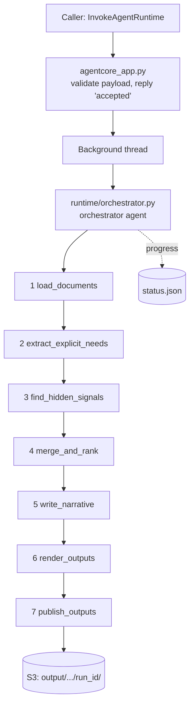

# Discovery Agent: Flow

This document describes how one discovery run moves through the code: which file is responsible for each step, where the data goes, and how each step works.

## 1. What a run does

**Input:** all documents for one customer engagement (transcripts, emails, chats, Word, PDF and text files) in S3 under `input/<engagement>/`.

**Output:** three files in S3 under `output/<engagement>/<run_id>/`:

| File | Description |
|---|---|
| `discovery.json` | Validated report for downstream agents |
| `README.md` | Standard-format report, rendered from the JSON |
| `discovery_report.docx` | Word version of the README |

A `status.json` is also written to the same folder during the run, and a `narrative.json` when the narrative step succeeds.

## 2. End-to-end flow



The orchestrator calls the seven tools one at a time, in a fixed order. It never sees customer documents. Each tool returns only a short status summary to it.

## 3. Entry point

**File:** `agentcore_app.py`

1. AgentCore Runtime receives the request on `/invocations`.
2. The payload is validated (`RunConfig.from_payload`). A bad payload is rejected before anything starts.
3. If `status.json` for this run already shows `running` or `succeeded`, the call returns `already_started` and no second run begins (unless `resume` is set).
4. Otherwise the run starts in a background thread and the call returns `accepted` immediately. The runtime is told it is busy so the session is not closed while the run is in progress.
5. The caller reads progress and the final result from `status.json` in S3.

Payload:

```json
{"engagement": "Ingram", "input_prefix": "input/Ingram/", "output_prefix": "output/Ingram/",
 "run_id": "optional", "options": {"narrative": true, "resume": false}}
```

## 4. Orchestrator

**Files:** `discovery_agent/runtime/orchestrator.py`, `discovery_agent/prompts/orchestrator.md`

- One Strands agent with the seven tools, running on a small model.
- A sequential tool executor runs one tool at a time.
- The prompt tells it the order, to stop on a fatal error, and to call a missing earlier step if it is told one is required.
- The orchestrator's reply is not used to decide the outcome. After it finishes, the code checks the run state: if any step failed or is missing, the run is marked `failed`; otherwise `succeeded`.

## 5. The seven steps

Each tool lives in `discovery_agent/tools/<step>.py` and is a thin wrapper. The actual work is done by the files in the "Does the work" column.

| # | Tool | Does the work | Reads | Writes (work area) | Model |
|---|---|---|---|---|---|
| 1 | `load_documents` | `data/documents.py`, `analysis/trim.py` | `input/<engagement>/` | `work/.../load_documents.json` | Haiku (trim only, if corpus is over budget) |
| 2 | `extract_explicit_needs` | `analysis/pipeline.py`, `analysis/assemble.py`, `prompts/extraction.md` | Corpus from step 1 | `work/.../extract_explicit_needs.json` | Sonnet |
| 3 | `find_hidden_signals` | `analysis/pipeline.py`, `analysis/assemble.py`, `prompts/hidden_signals.md` | Corpus + step 2 result | `work/.../find_hidden_signals.json` | Opus |
| 4 | `merge_and_rank` | `analysis/assemble.py`, `analysis/validate.py`, `schema/report.schema.json` | Steps 2 and 3 | `work/.../merge_and_rank.json` | None (code only) |
| 5 | `write_narrative` | `analysis/pipeline.py`, `prompts/narrative.md` | Validated report | `work/.../write_narrative.json` | Haiku |
| 6 | `render_outputs` | `rendering/readme.py`, `rendering/word.py` | Report + narrative | `work/.../files/` | None (code only) |
| 7 | `publish_outputs` | `tools/publish_outputs.py` | `work/.../files/` | `output/<engagement>/<run_id>/` | None |

### Step 1: load_documents
- Lists the files under the input prefix. Hidden files and file types other than `.txt .md .eml .docx .pdf` (or no extension) are ignored. File names must be unique.
- Files are parsed in a temporary folder. They are only read, never executed.
- Each document is classified as transcript, email, chat or document. Transcript headers are removed and speaker names are recorded.
- The corpus is the full text of all documents. Its budget is about 150k tokens. If it is over budget, small talk is trimmed from large documents: a small model chooses which turns to keep, and code cuts those turns from the original text, so every kept passage is still verbatim. If it is still over budget, the run stops with an error.

### Step 2: extract_explicit_needs
- One model call over the whole corpus extracts what customers stated: use cases, goals, pain points, current state, constraints, stakeholders and open questions, each with quotes.
- Unsupported items are removed by code (see section 6). The model is not asked to rewrite them.

### Step 3: find_hidden_signals
- One model call over the whole corpus, plus the cleaned step 2 result so it does not repeat explicit needs.
- It looks for implied, latent and adjacent use cases, using patterns that only show across documents (repeated complaints, conflicting statements, follow-ups that never happened).
- The same code cleanup as step 2 is applied.

### Step 4: merge_and_rank
- Plain code, no model. Combines both passes, assigns ids, ranks use cases, selects the top hidden opportunities and compiles open questions.
- Validates the result against the JSON schema and the content checks in section 6.

### Step 5: write_narrative
- A small model writes the executive summary and short use case summaries from the validated report.
- This step is non-fatal. If the narrative cannot pass validation, it is skipped and the report is produced without it.

### Step 6: render_outputs
- `readme.py` renders `README.md` from the JSON and narrative. `word.py` converts that Markdown into the Word file.
- Files are written to the work area first.

### Step 7: publish_outputs
- Copies the finished files from the work area to `output/<engagement>/<run_id>/`.

## 6. Validation and checks

**Files:** `analysis/validate.py`, `analysis/assemble.py`, `analysis/transcript.py`, `schema/report.schema.json`

| Check | Rule |
|---|---|
| Schema | Output must match `report.schema.json` |
| Quotes | Every quote must appear in the cited document (filler words such as "uh" and "um" are ignored) |
| Speakers | The named speaker must exist in that transcript |
| Systems | Every system named must appear in the documents |
| Numbers | A number in analysis text must appear in the item's cited quotes |
| Wording | The word "clients" is rejected; "customers" is used |

Items that fail a check are removed in code during steps 2 and 3. A model retry happens only when the output is unusable (invalid JSON or cut off), at most twice. Logs record problem kinds and counts only, never customer text.

## 7. Guards on every tool

**File:** `discovery_agent/tools/runner.py`

Every tool goes through the same function, `run_step`:

1. **Failed run:** if the run has already failed, the tool returns a fatal error.
2. **Single use:** a step that already completed returns "already done".
3. **Order:** prerequisites are checked (`PREREQS` in `runtime/state.py`). A step called too early returns a precondition error naming the step needed first.
4. **Checkpoint:** a successful result is saved to `work/<engagement>/<run_id>/<step>.json`.
5. **Resume:** if `options.resume` is true, a saved checkpoint is loaded instead of recomputing the step.
6. **Failure:** a fatal step failure marks the run `failed`. A non-fatal failure (narrative only) is recorded and the run continues.
7. **Status:** `status.json` is updated after every step.

Tools take no arguments from the model. Everything they need is held in the run state (`runtime/state.py`).

## 8. Storage and status

**Files:** `data/storage.py`, `settings.py`

| Location | Contents |
|---|---|
| `input/<engagement>/` | Source documents |
| `work/<engagement>/<run_id>/` | Step checkpoints and rendered files (contain document text) |
| `output/<engagement>/<run_id>/` | Final files and `status.json` |

- In the runtime, files are stored in the S3 bucket with KMS encryption. On a development machine they are stored under `samples/_store`.
- `status.json` fields: `state` (`running`, `succeeded` or `failed`), `completed_steps`, per-step details, `error`, `output_keys` and `updated_at`.

## 9. Models

All set in `discovery_agent/settings.py`. There are no environment variables.

| Stage | Model |
|---|---|
| Extraction | Sonnet 5.5 |
| Hidden signals | Opus 5.5 |
| Narrative, trim, orchestrator | Haiku |

## 10. File map

```
agentcore_app.py                  Entry point, background run
discovery_agent/
  settings.py                     All configuration
  runtime/orchestrator.py         Orchestrator agent, final success decision
  runtime/state.py                Run config, step order, checkpoints, status.json
  tools/                          Seven tools (one file each) + runner.py guards
  analysis/pipeline.py            Model calls, retries, corpus build
  analysis/assemble.py            Cleanup, merge, rank
  analysis/validate.py            Schema and content checks
  analysis/trim.py                Small-talk trimming
  data/documents.py               File parsing and classification
  data/storage.py                 S3 and local storage
  rendering/readme.py             JSON to README.md
  rendering/word.py               README.md to Word
  prompts/                        One prompt per model stage
schema/report.schema.json         Report structure
```
