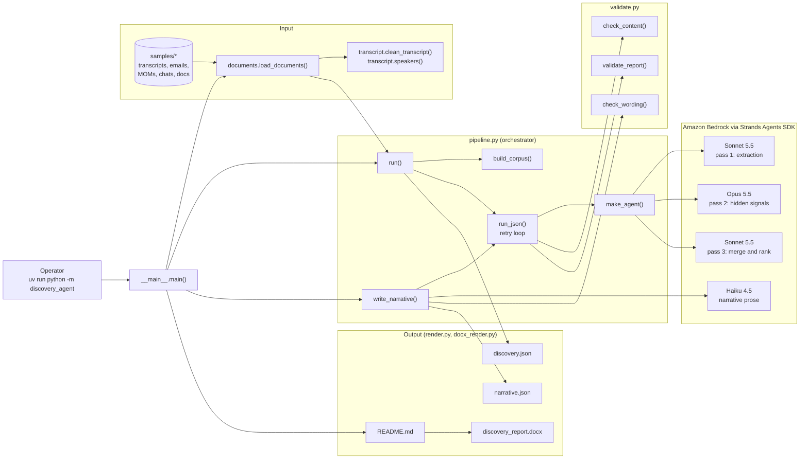
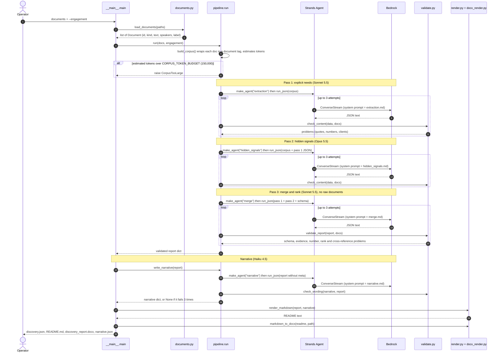
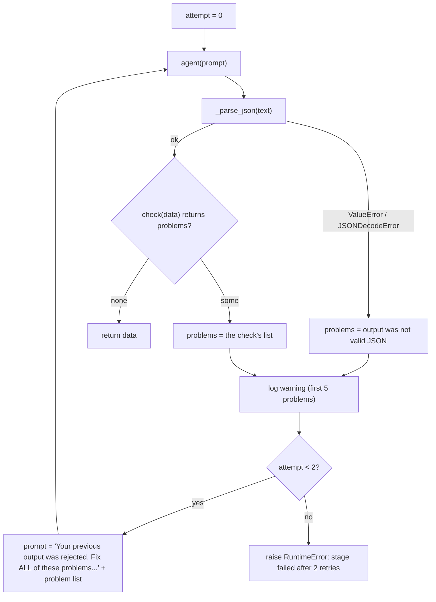
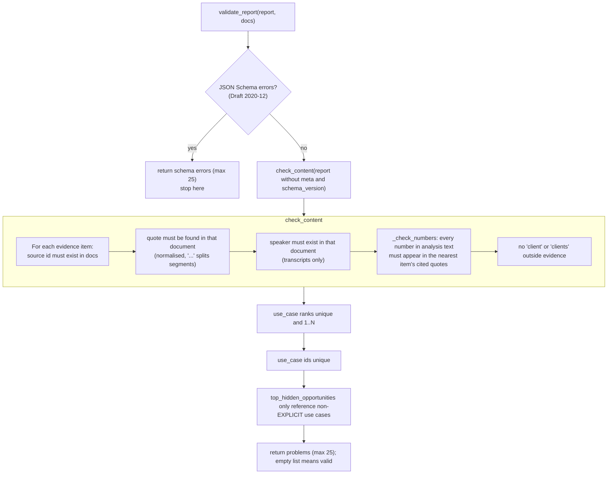
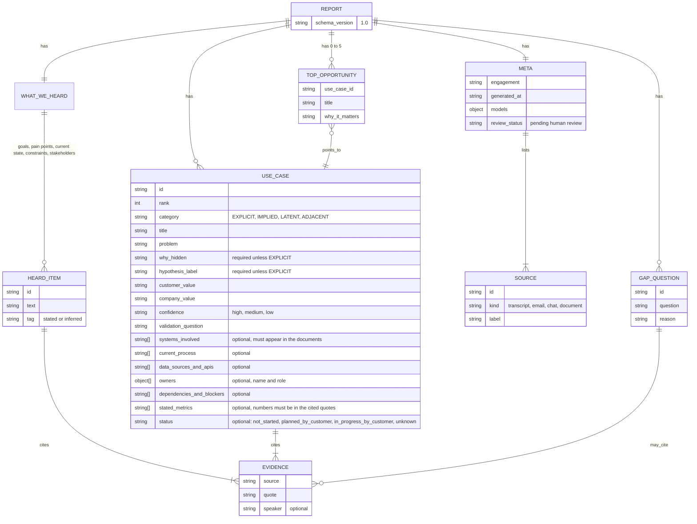
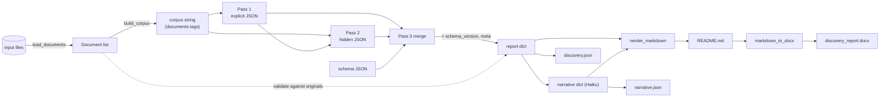
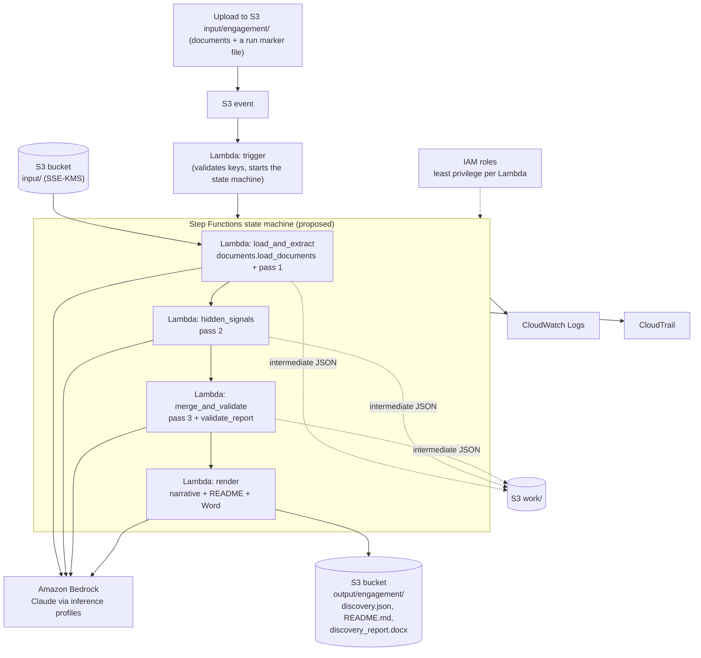

# Discovery Agent: Architecture and Code Walkthrough

> **Update: the analysis core was simplified after this document was written.** Where the text below describes three model passes (extraction, hidden signals, merge), read it as follows:
> - **The merge model call is gone.** `merge_and_rank` (the tool and `pipeline.merge_report`) is now plain code in `discovery_agent/assemble.py`: it repairs, combines, ranks, numbers and labels the two passes' findings. `prompts/merge.md` is no longer used.
> - **Repair instead of retry.** After each pass, code removes anything the documents do not support (quotes not found verbatim, systems never named, numbers not in the cited quotes, owner names or roles not in the documents). `run_json` now retries only for unusable output (invalid JSON, cut-off output).
> - **Ranking is a rule:** the `priority` (1 to 3) each pass assigns, then confidence, then how many documents back the finding, then original order. Top hidden opportunities are the first five non-explicit use cases.
> - **Large inputs:** when the corpus is over the token budget, `discovery_agent/trim.py` lets Haiku choose which turns to keep and code cuts them from the original text (quotes stay verbatim). On the five real documents this removed only 2 to 7%, so it is a modest safety valve, not a scaling solution.
> - **Models used:** extraction (Sonnet), hidden signals (Opus), optional narrative (Haiku), and trim (Haiku) only when needed.
> - **Tests:** 75 offline tests (`uv run python -m unittest discover -s tests -t .`).

How the agent works under the hood, at code level.

> **Read this first: what is built and what is not.**
>
> | Layer | Status |
> |---|---|
> | Local pipeline (`python -m discovery_agent ...`): load documents, three Bedrock passes via Strands, validation, README + Word + JSON output | **Built and run** (one real run on 2 documents) |
> | S3 trigger, Lambda handler(s), IAM, CloudWatch, CloudTrail, Terraform | **Not built.** Section 9 is a proposal, not code. |
>
> There are **no Lambdas yet**. The orchestrator today is `pipeline.run()` in `discovery_agent/pipeline.py`, called from `discovery_agent/__main__.py`. Any future Lambda handler will be a thin wrapper around those same functions.

---

## 1. Repository map

```text
Ingram_Discovery-agent/
├── discovery_agent/
│   ├── __main__.py          CLI entry point
│   ├── analysis/            pipeline.py (model passes, retry loop), assemble.py (repair + rank + assemble, no model),
│   │                        validate.py (schema, evidence, number, wording checks), trim.py, transcript.py
│   ├── data/                documents.py (load + classify input files), storage.py (local disk or S3)
│   ├── rendering/           readme.py (report -> README.md), word.py (README.md -> .docx)
│   ├── runtime/             orchestrator.py (the orchestrator agent), state.py (run state, checkpoints, status file)
│   ├── tools/               the 7 orchestrator tools, one file each, plus runner.py
│   └── prompts/             extraction.md, hidden_signals.md, narrative.md, trim.md, orchestrator.md
├── agentcore_app.py         AgentCore Runtime entry point (the only file that uses the AgentCore SDK)
├── schema/report.schema.json
├── scripts/                 build_package.sh, trigger_lambda.py, invoke_runtime.py, watch_run.py, iam/*.json
├── tests/                   offline unit tests
└── docs/                    this folder
```

> Older sections below use the previous flat file names (for example `pipeline.py`, `state.py`); the files are the same,
> now grouped into the folders above. `merge.md` and the Dockerfile were removed (no merge model call; ZIP deployment).

---

## 2. System overview (as built)



---

## 3. One run, step by step



Notes:
- Each stage creates a **fresh** `Agent`, so stages share no conversation history. They share data only through the prompts that `run()` builds.
- Pass 2 receives pass 1's JSON so it does not repeat explicit use cases.
- Pass 3 never sees the raw documents. It receives only the two passes' JSON plus the schema, which is why quotes must be re-verified against the original documents in `validate_report`.
- Observed on one run with 2 documents: about 16 minutes end to end. Retries are a big part of it. Each `ConverseStream` call on the full corpus takes minutes.

---

## 4. Module walkthrough

### 4.1 `__main__.py`: entry point

`main()` (the only function):
1. Parses `documents...`, `--engagement` (required), `--out` (default `samples/_reports`), `--no-narrative`.
2. `run(load_documents(paths), engagement)` returns the validated report.
3. `write_narrative(report)` returns the Haiku prose, or `None`.
4. Writes `<out>/<engagement>/`: `discovery.json` (for other agents), `README.md` (from `render_markdown`), `discovery_report.docx` (from `markdown_to_docx(readme)`, so Word always mirrors the README), and `narrative.json` when a narrative exists, so the README can be re-rendered without another model call.

### 4.2 `documents.py`: input loading

| Function | What it does |
|---|---|
| `Document` (dataclass) | `id` (file name), `kind` (`transcript` / `email` / `chat` / `document`), `text`, `speakers` (set), `label` (readable name) |
| `_read(path)` | By extension: `.eml` is parsed with the stdlib `email` parser and the From/To/Cc/Date/Subject headers are prepended to the body; `.docx` yields paragraphs plus table rows (`python-docx`); `.pdf` yields page text (`pypdf`); anything else is read as UTF-8 text. Returns `(text, forced_kind)`. |
| `_label(raw, fallback)` | Turns a call header like `Sep 22` plus `Re: [EXTERNAL]Re: Title` into `Sep 22 · Title`. Falls back to the file name. |
| `load_document(path)` | Reads, labels, and classifies. If the kind was not forced it is guessed: 10 or more `m:ss` timestamp lines gives transcript; text starting with `From:`, `Subject:` or `To:` gives email; 10 or more chat-style lines gives chat; otherwise document. Transcripts are passed through `clean_transcript` and get a speaker set. |
| `load_documents(paths)` | Loads all paths and raises `ValueError` on duplicate file names, because the file name is the citation id. |

### 4.3 `transcript.py`: text helpers

| Function | What it does |
|---|---|
| `clean_transcript(raw)` | Drops everything up to the line `Transcript` (and a following `Speakers` line). This removes the auto-generated meeting summary so quotes can only come from the real transcript. Returns the input unchanged if no such line exists. |
| `speakers(text)` | A non-empty line directly followed by an `m:ss` or `h:mm:ss` line is a speaker name. Used to reject quotes attributed to people who do not exist in that document. |
| `normalize(text)` | Lowercases, strips punctuation, removes spoken fillers (`uh`, `um`, `er`, `ah`, `hmm`, `mm`), and collapses immediate word repeats (`which, which` becomes `which`). Applied to both the quote and the source, so a model that tidied disfluencies still matches. |

### 4.4 `pipeline.py`: the orchestrator

Constants:
- `MODELS`: stage to `(env var, default model id)`.
  - `extraction` is Sonnet 5.5 (`EXTRACTION_MODEL_ID`).
  - `hidden_signals` is Opus 5.5 (`HIDDEN_SIGNALS_MODEL_ID`).
  - `merge` is Sonnet 5.5 (`MERGE_MODEL_ID`).
  - `narrative` is Haiku 4.5 (`NARRATIVE_MODEL_ID`).
- `MAX_RETRIES = 2`, so each stage gets 3 attempts.
- `CORPUS_TOKEN_BUDGET` (default 150000, env-overridable).

Functions:

| Function | Behaviour |
|---|---|
| `model_id(stage)` | Env var if set, else the default. |
| `make_agent(stage, prompt_file)` | Builds a `boto3.Session` (profile from `AWS_PROFILE_NAME` if set, region from `AWS_REGION`, default `us-east-1`; in Lambda the profile is unset and the execution role is used). Wraps a Strands `BedrockModel` (`max_tokens=32000`, `CacheConfig(strategy="auto")`) in an `Agent` with the prompt file as the system prompt, no tools, and no streaming callback. |
| `_parse_json(text)` | Strips code fences, takes the span from the first `{` to the last `}`, and runs `json.loads`. |
| `run_json(agent, prompt, check, stage)` | The retry loop (see 4.4.1). |
| `build_corpus(docs)` | Wraps each document as `<document id=.. kind=..>...</document>` inside `<documents>`. Estimates tokens as `len / 3.5` and raises `CorpusTooLarge` when over budget. The planned topic-clustered fallback for oversized corpora is **not built**. |
| `run(docs, engagement)` | The 3-pass flow, builds `meta`, returns the validated report. |
| `write_narrative(report)` | Haiku prose, with its own checks (see 4.4.3). Returns `None` on failure. |

#### 4.4.1 `run_json` retry loop



Details worth knowing:
- The **same** `Agent` object is reused, so the model sees its previous answer and the problem list.
- `cache_config` lets Bedrock reuse the cached corpus prefix on retries.
- `check` is `None` for no extra checks, as in some stages.

#### 4.4.2 `run`: the three passes

1. **Pass 1** (`extraction.md`): input is the corpus. Output keys: `what_we_heard`, `explicit_use_cases`, `open_questions`. Checked with `check_content(data, by_id)`.
2. **Pass 2** (`hidden_signals.md`): input is the corpus plus pass 1 JSON in `<explicit_extraction>`. Output keys: `hidden_use_cases` (IMPLIED, LATENT, ADJACENT), `inferred_heard_items`, `open_questions`. Same checks.
3. **Pass 3** (`merge.md`): input is `<pass1_explicit>`, `<pass2_hidden>`, `<document_order>`, and `<json_schema>`. The code builds `meta` (engagement, sources with kind and label, UTC timestamp, model ids per stage, `review_status = "pending human review"`). Inside the retry loop, `check` assembles `{"schema_version": "1.0", "meta": meta, **data}` and runs `validate_report`. The model is told not to output `schema_version` or `meta`, so code owns them.

#### 4.4.3 `write_narrative`

Haiku receives the validated report without `meta` and returns `executive_summary` (list of paragraphs), `use_case_summaries` (one per use case id), and `opportunity_narratives` (one per top-opportunity id). Checks: exact id coverage on both maps, a non-empty summary, and `check_wording(n, report)`, which applies the number rule against the report's quotes plus the `customers` wording rule. On three failures it logs an error and returns `None`, and the run still writes all outputs without the prose.

### 4.5 `validate.py`: the guard layer



Key points:
- **Verbatim quotes:** matching is on `normalize()`d text, so punctuation, spoken fillers and word repeats are forgiven but wording is not.
- **Numbers rule:** replaced an earlier rule that banned all durations and amounts. A customer metric such as "30-minute call" is kept when the quote contains it; invented figures are rejected. `_check_numbers` narrows the allowed set to the cited quotes of the nearest enclosing item. Strings that look like ids (`UC-1`, `H-2`, `Q-3`) and `id`/`use_case_id`/`source` fields are exempt.
- **Pricing and timeline estimates by us** are discouraged by the prompts and indirectly blocked by the number rule. They are not checked for as a concept.
- Returns at most 25 problems so the retry prompt stays small.
- **Systems rule:** every entry of a `systems_involved` list must appear in at least one source document (normalised), so a tool name the customers never mentioned is rejected.

### 4.6 `render.py`: report JSON to README

- `render_markdown(report, narrative)` returns the README in a fixed template: a header table (engagement, sources with full names, date, status), the hypothesis note, an executive summary (Haiku), then 1 Discovery summary (ranked table), 2 Top hidden opportunities, 3 Use cases (fixed field order per use case), 4 What we heard, 5 Gaps and open questions.
- `pick_evidence(evidence, n=2)`: shows up to two quotes per item, preferring one per source and a readable mid length (about 140 characters). `_trim` cuts at 240 characters on a word boundary. The count left out is shown as "(+N more in the JSON report)". The full set stays in the JSON.
- `ev_line` prints a quote with speaker and the call date (`Sep 22`, taken from the label before ` · `).
- `source_labels(report)` maps source id to readable name.
- `HYPOTHESIS = "hypothesis, not confirmed"` marks every non-EXPLICIT item.

### 4.7 `docx_render.py`: README to Word

`markdown_to_docx(markdown, path)` is a small converter for the Markdown subset the renderer emits: headings (`#` becomes Title), paragraphs, block quotes, nested bullets (up to three levels), numbered items, pipe tables (header row shaded, repeated on page breaks), and `**bold**`, `_italic_`, `` `code` `` inline. A4 page, 1-inch margins, Calibri, page-number footer. No branding.

### 4.8 `schema/report.schema.json`



Rules the schema enforces: every heard item and use case needs at least one evidence entry; the `if/then/else` on `category` forces the hypothesis fields on IMPLIED, LATENT and ADJACENT items and forbids them on EXPLICIT; `top_hidden_opportunities` allows 0 to 5 entries (not forced to 3, to avoid padding with unsupported findings); `additionalProperties: false` on the main objects.

---

## 5. Data flow between stages



---

## 6. Configuration

> **Superseded:** the environment variables below are no longer read. The same values are fixed in `discovery_agent/settings.py`.

| Variable | Default | Purpose |
|---|---|---|
| `AWS_PROFILE_NAME` | unset | Local SSO profile (we use `agentic_systems`). Leave unset in Lambda so the execution role is used. |
| `AWS_REGION` | `us-east-1` | Bedrock region |
| `EXTRACTION_MODEL_ID` | `us.anthropic.claude-sonnet-5-5` | Pass 1 |
| `HIDDEN_SIGNALS_MODEL_ID` | `us.anthropic.claude-opus-5-5` | Pass 2 |
| `MERGE_MODEL_ID` | `us.anthropic.claude-sonnet-5-5` | Pass 3 |
| `NARRATIVE_MODEL_ID` | `us.anthropic.claude-haiku-4-5-20251001-v1:0` | Prose |
| `CORPUS_TOKEN_BUDGET` | `150000` | Max estimated corpus tokens before `CorpusTooLarge` |

Things learned from the real run:
- All three model ids above worked in us-east-1 on the `agentic_systems` account.
- A bare model id (`anthropic.claude-opus-5-5`) fails: on-demand throughput is not supported, so the **`us.` inference-profile prefix** is required.
- Sonnet 5.5 rejects the `temperature` parameter, so none is set.

Run it:

```bash
AWS_PROFILE_NAME=agentic_systems uv run python -m discovery_agent \
    samples/sep_3 samples/sep_15 samples/sep_22 samples/sep_28 \
    --engagement Ingram
```

---

## 7. Failure behaviour

| Situation | What happens |
|---|---|
| Corpus over budget | `CorpusTooLarge` is raised before any model call. |
| Model returns invalid JSON or fails validation | Re-prompted with the problem list, up to 2 retries. |
| Still failing after retries (passes 1 to 3) | `RuntimeError`, the run stops, nothing is written. |
| Narrative still failing after retries | Logged, outputs are written without prose and the CLI says so. |
| AWS SSO token expired | boto3/botocore error from the first Bedrock call. Re-run the login. |

---

## 8. Known limitations (honest list)

1. **Content genericness: addressed, not yet re-measured.** Use cases now carry optional scoping fields (systems, process steps, data sources and APIs, owners, blockers, stated metrics, status). Systems must appear in the documents and numbers must come from the cited quotes. The effect on real output has not been measured yet; the next real run on the `sep` files should be compared against `oct_1-1`.
2. **Spelled-out numbers bypass the number rule** ("five-minute", "an hour"), because only digits are checked.
3. **The narrative is not checked for faithfulness.** Only wording, ids and number grounding are checked; Haiku could still phrase something loosely.
4. **Organisation is not known.** The code cannot tell customer attendees from Aivar or AWS attendees; that is left to the prompts.
5. **Speaker checks apply to transcripts only.**
6. **No stable ids across runs.** `UC-1` in one run may be a different use case in the next.
7. **Merge is LLM-based.** Duplicate detection and ranking depend on the model.
8. **Token estimate is a heuristic** (`chars / 3.5`).
9. **No fallback for oversized corpora.** Design only: chunk, embed, cluster by topic across documents, analyse each cluster, then merge.
10. **(Fixed) Logs used to include quote snippets.** Logs and error messages now carry only problem kinds and counts.
    Original note:  `run_json` logs the first 5 problems, which can contain 80-character quote fragments from customer documents. Fix this before anything runs in CloudWatch.

---

## 9. Target AWS architecture (proposed, NOT built)

> **Superseded.** The multi-Lambda / Step Functions design below was proposed because of the 15-minute Lambda limit. The chosen direction is a single orchestrator agent with sequential tools on AgentCore Runtime. See `docs/BLUEPRINT_ORCHESTRATOR.md`. The section is kept only for the record.

The brief calls for: encrypted S3 (`input/` and `output/` prefixes), Lambda in Python triggered by upload, Bedrock calls, IAM least privilege, CloudWatch logs, CloudTrail, Terraform. We chose Terraform.

**A design constraint found by the real run:** one analysis took about 16 minutes (2 documents), and a Lambda is capped at 15 minutes. A single "do everything" Lambda will time out. The proposal below splits the work so each step stays well under the cap.



What would be reused as is: every function in `discovery_agent/`. A handler would do roughly "read objects from S3, call the same function, write the result to S3". `make_agent` already omits the profile when `AWS_PROFILE_NAME` is unset, which is the Lambda case.

What would need building: the handlers, per-stage intermediate state in S3, the Terraform (bucket with encryption, event notification, four Lambdas and a state machine, IAM, log groups, CloudTrail), packaging of dependencies, and deciding how the model response size and the 6 MB Lambda payload limit are handled (pass S3 keys, not data).

**Decisions needed from you**
- Is Step Functions acceptable? Your brief said to keep the architecture simple, and the real run time makes a single Lambda unsafe.
- Trigger: a marker file such as `input/<engagement>/_run` (so a half-uploaded batch is not analysed), or a run on every upload?
- Whether to build the oversized-corpus fallback first or after the first deployment.

---

## 10. Before any deployment

- Fix the log content issue (limitation 10).
- Decide the orchestration approach above.
- Add the content-quality changes (specifics fields) and re-validate once against the `oct_1` and `oct_1-1` calls.
- Add a test set for the validators (quote matching, number rule, schema rules), since they carry most of the report's integrity.
