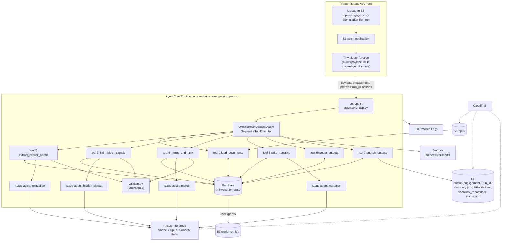
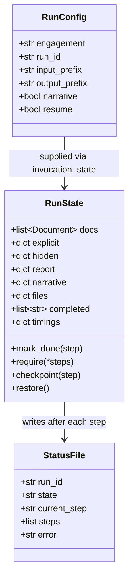
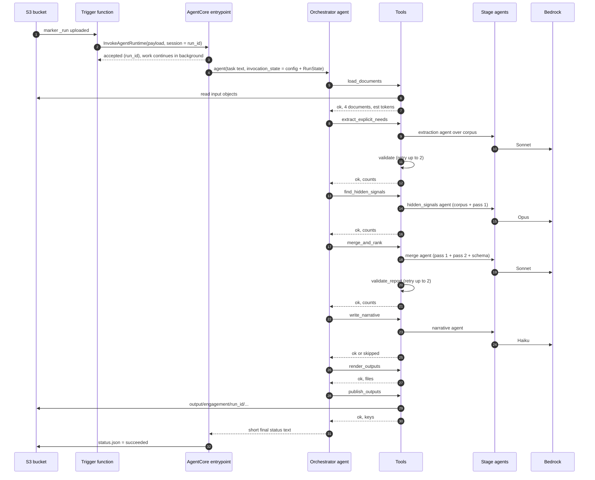
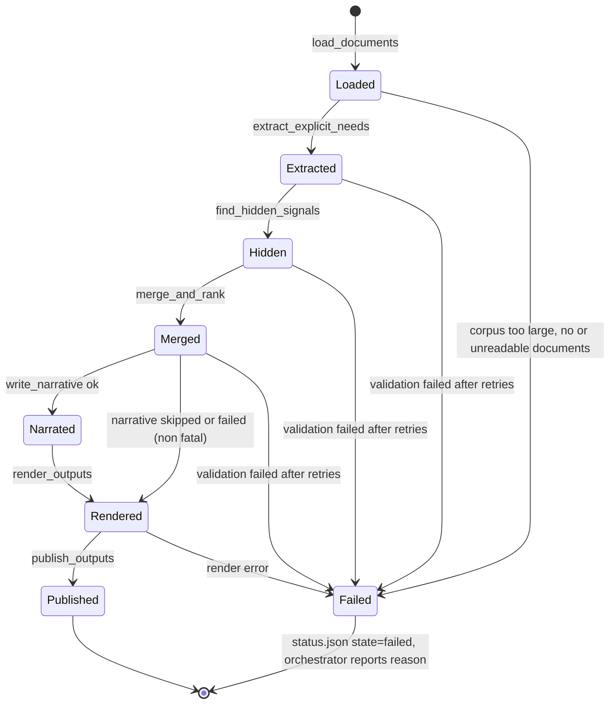

# Blueprint: Single Orchestrator Agent with Sequential Tools (AgentCore Runtime)

> **Update: the analysis core was simplified after this document was written.** Where the text below describes three model passes (extraction, hidden signals, merge), read it as follows:
> - **The merge model call is gone.** `merge_and_rank` (the tool and `pipeline.merge_report`) is now plain code in `discovery_agent/assemble.py`: it repairs, combines, ranks, numbers and labels the two passes' findings. `prompts/merge.md` is no longer used.
> - **Repair instead of retry.** After each pass, code removes anything the documents do not support (quotes not found verbatim, systems never named, numbers not in the cited quotes, owner names or roles not in the documents). `run_json` now retries only for unusable output (invalid JSON, cut-off output).
> - **Ranking is a rule:** the `priority` (1 to 3) each pass assigns, then confidence, then how many documents back the finding, then original order. Top hidden opportunities are the first five non-explicit use cases.
> - **Large inputs:** when the corpus is over the token budget, `discovery_agent/trim.py` lets Haiku choose which turns to keep and code cuts them from the original text (quotes stay verbatim). On the five real documents this removed only 2 to 7%, so it is a modest safety valve, not a scaling solution.
> - **Models used:** extraction (Sonnet), hidden signals (Opus), optional narrative (Haiku), and trim (Haiku) only when needed.
> - **Tests:** 75 offline tests (`uv run python -m unittest discover -s tests -t .`).

Design for the next version of the discovery agent: **one Strands orchestrator agent that owns a fixed set of tools and calls them one at a time, in order**, hosted on **Amazon Bedrock AgentCore Runtime**.

> **Status: steps 1 to 5 of the build order are implemented and unit-tested offline; Terraform (step 6) and the first real end-to-end run (step 7) are not done.** See section 17 for exactly what is verified.
>
> The pipeline (`pipeline.py`) is now split into stage functions; the orchestrator, tools, run state, storage and AgentCore entrypoint are new files that wrap them.
>
> This document **supersedes section 9 of `docs/ARCHITECTURE.md`** (the multi-Lambda / Step Functions proposal).

---

## 1. Decision and what it means

| | Current code | This blueprint (Option B) |
|---|---|---|
| Who decides the order of steps | Python code in `pipeline.run()` | An orchestrator **agent** (LLM), constrained to a fixed order |
| Strands `Agent` objects | 4, one per stage, each tool-less | 1 orchestrator with 7 tools, plus the 4 stage agents running **inside** the tools = 5 |
| Where the heavy analysis happens | Stage agents called directly | Stage agents called from inside tools |
| Hosting | Local CLI | AgentCore Runtime (one container, one entrypoint) |
| 15-minute limit | n/a | Removed by moving off Lambda (to be confirmed in AgentCore docs, see section 11) |

**Candid trade-off.** If the tools take no model-chosen arguments and must run in a fixed order, the orchestrator LLM adds little decision-making. What it adds is a natural-language task interface, a uniform "agent" shape for AgentCore, error reporting in plain language, and extension points (for example, later adding a human-review tool or an ask-the-user step). The costs are extra latency and tokens (small, see section 12) and a non-zero chance the model misbehaves. Section 4 shows how the design makes misbehaviour harmless.

---

## 2. Design principles

1. **The model sequences; code guarantees.** Order is enforced four ways (section 4), so a wrong model decision cannot produce a wrong result.
2. **Customer content never passes through the orchestrator's context.** Documents and analysis live in run state outside the conversation. Tools return short summaries only. This keeps the orchestrator cheap, fast, and unable to "retype" quotes.
3. **Tools take no model-supplied arguments.** Configuration (engagement, S3 prefixes, options) comes from the invocation payload through `invocation_state`. The model chooses *when* to call a tool, never *with what data*.
4. **Every step checkpoints.** Each tool writes its result to S3 so a failed or restarted session can resume without repaying earlier model calls.
5. **Validation stays inside the tools.** The existing guard layer (`validate.py`) is unchanged. A tool returns `ok` only for output that passed validation.
6. **No customer text in logs or traces.**

---

## 3. Architecture



---

## 4. How sequential execution is enforced

The orchestrator model is told the order, but the system does not depend on it obeying.

| Layer | Mechanism | Stops what |
|---|---|---|
| 1. Executor | `Agent(tool_executor=SequentialToolExecutor())` (verified present in Strands 1.58.1) | Two tool calls in one turn running in parallel |
| 2. Preconditions | Each tool checks `RunState.completed` for its prerequisites and returns `{"status":"error","reason":"requires extract_explicit_needs first"}` if not met | Out-of-order calls (for example hidden signals before extraction) |
| 3. Single-use guard | A tool that already succeeded returns `{"status":"ok","note":"already done"}` without re-running | A model looping or retrying a finished, expensive step (Opus calls cost real money) |
| 4. System prompt | States the exact order, one call per turn, stop on error | The common case: the model simply follows it |

Layers 1 to 3 are code. Layer 4 is only guidance.

---

## 5. Tool catalogue

All tools use `@tool(context=True)` (verified in Strands 1.58.1) so they can read the shared `RunState` and config from `tool_context.invocation_state`. None takes arguments from the model.

| # | Tool | Needs first | What it does | Returned to the model (short) | Failure |
|---|---|---|---|---|---|
| 1 | `load_documents` | none | Lists the input prefix, reads each object (S3 or local), runs `documents.load_document`, builds the corpus, runs the token budget check | `{status, documents:[{id, kind, label}], est_tokens}` | `CorpusTooLarge`, unreadable file, no documents: **fatal** |
| 2 | `extract_explicit_needs` | 1 | Pass 1: `extraction` stage agent over the corpus; `check_content` with retries | `{status, counts:{explicit_use_cases, heard_items, open_questions}, attempts}` | Fails after retries: **fatal** |
| 3 | `find_hidden_signals` | 1, 2 | Pass 2: `hidden_signals` stage agent (Opus) over corpus + pass 1 JSON | `{status, counts:{hidden_use_cases, ...}, attempts}` | **fatal** |
| 4 | `merge_and_rank` | 2, 3 | Pass 3: `merge` stage agent; `validate_report` (schema, evidence, numbers, ranks, cross-references) | `{status, counts:{use_cases, top_opportunities, open_questions}, attempts}` | **fatal** |
| 5 | `write_narrative` | 4 | Haiku prose, `check_wording`; skipped if payload `options.narrative` is false | `{status}` or `{status:"skipped"}` | **non-fatal**: orchestrator continues, outputs are written without prose |
| 6 | `render_outputs` | 4, 5 | `render_markdown` (README), `markdown_to_docx`, serialise `discovery.json` and `narrative.json` into the run's work area | `{status, files:[...]}` | **fatal** |
| 7 | `publish_outputs` | 6 | Copies the files to `output/<engagement>/<run_id>/` and writes `status.json` | `{status, output_keys:[...]}` | **fatal** |

Tool 1 is a thin wrapper around the existing `documents.load_documents()` that adds S3 access and state handling; tools 2 to 4 are thin wrappers around the stage functions that `pipeline.py` will expose.

Every tool, on exit: appends to `RunState.completed`, writes a checkpoint to `work/<run_id>/<tool>.json`, updates `status.json`, and logs one structured line (run_id, tool, seconds, attempts, counts). It does **not** log quotes or document text.

---

## 6. Run state and checkpoints



- **Where it lives:** inside `invocation_state` for the duration of one invocation. Not a module-level global, so concurrent invocations in one process cannot interfere.
- **Checkpoints:** `work/<run_id>/<step>.json` in the encrypted bucket. `resume=true` makes each tool restore its checkpoint and return `ok` immediately instead of calling the model again.
- **`status.json`:** `{run_id, state: running|succeeded|failed, current_step, steps:[{name, status, started, ended, attempts}], error}`. This is how callers learn the result, since the entrypoint returns before the run finishes (section 8).

---

## 7. One run, end to end



---

## 8. Run lifecycle and failures



- **Fatal error:** the tool returns `{"status":"error","reason":...}`. The orchestrator must stop and reply with the reason. The entrypoint also sets `status.json` to `failed`, so a misbehaving model cannot mask a failure.
- **Orchestrator misbehaves** (skips, loops, ends early): the entrypoint checks `RunState.completed` after the agent returns. If `publish_outputs` is not in it, the run is marked failed with "orchestrator ended before publishing". The code never reports success based on the model's words.
- **Session dies:** a new invocation with `resume=true` restores checkpoints and continues from the first missing step.

---

## 9. Orchestrator prompt (draft, `prompts/orchestrator.md`)

```text
You are the Discovery Orchestrator. You run the discovery pipeline for one customer
engagement by calling tools. You never see or handle customer documents; tool results
are short status summaries.

Call the tools in exactly this order, ONE tool per turn, waiting for each result:
1. load_documents
2. extract_explicit_needs
3. find_hidden_signals
4. merge_and_rank
5. write_narrative
6. render_outputs
7. publish_outputs

Rules:
- Never call two tools in the same turn. Never call a tool that already succeeded.
- If a tool returns status "error", stop immediately and reply with its reason.
  The only exception is write_narrative: if it errors or is skipped, continue with step 6.
- Do not invent, summarise or restate analysis content. You have none.
- Your final reply is a short plain-language status: what completed, and the output keys
  returned by publish_outputs. Use the word "customers", never "clients".
```

---

## 10. Invocation contract

**Payload** (from the trigger function or a manual call):

```json
{
  "engagement": "Ingram",
  "input_prefix": "input/Ingram/",
  "output_prefix": "output/Ingram/",
  "run_id": "2026-10-08T10-30-00Z",
  "options": { "narrative": true, "resume": false }
}
```

**Outputs**, in `output/<engagement>/<run_id>/`: `discovery.json` (for other agents), `README.md` (standard format), `discovery_report.docx` (converted from the README), `narrative.json`, `status.json`.

**Return value:** the entrypoint answers quickly with `{run_id, status: "accepted"}` and does the work as a background task; callers poll `status.json`. (AgentCore details to confirm, section 11.)

---

## 11. AgentCore Runtime: what is verified and what is not

I have **not** installed or read the AgentCore SDK or documentation in this session. Treat everything below as an assumption to verify before building.

| Item | Assumption | Verified? |
|---|---|---|
| Hosting model | Container with an HTTP service exposing an invocation route and a health route | No |
| Python SDK | `bedrock_agentcore` package with a runtime app class and an entrypoint decorator | No (package not installed here) |
| Long runs | Sessions can run far longer than 15 minutes; long work uses a background/async-task pattern so the health status reports busy | No |
| Synchronous request time limit | Unknown; possibly shorter than a full run, hence "accept then work in background" | No |
| Container architecture | ARM64 image in ECR | No |
| Session isolation | Separate session per `runtimeSessionId`; use `run_id` | No |
| Terraform support | An AWS provider resource for the runtime | No |
| Trace content | Strands/AgentCore telemetry may capture prompts and outputs | No, must check and disable content capture |
| Strands `SequentialToolExecutor` | Exists | **Yes** (1.58.1) |
| `@tool(context=True)` with `invocation_state` | Exists | **Yes** (1.58.1) |
| `Agent(state=...)`, `agent(prompt, invocation_state=...)` | Exist | **Yes** (1.58.1) |

---

> **Update (verified against the AWS documentation and by a local test with the real SDK):** the AgentCore assumptions in the table above are largely confirmed: ARM64 container on port 8080 with `/invocations` and `/ping`; `BedrockAgentCoreApp` with `@app.entrypoint` and `app.run()`; asynchronous jobs up to 8 hours; a 15-minute idle timeout (so a long run must register with `add_async_task` / `complete_async_task`, which `agentcore_app.py` now does); a 15-minute limit on synchronous requests; a 33-character minimum session id; and an `aws_bedrockagentcore_agent_runtime` Terraform resource. Still unverified: the Docker build, the trigger Lambda, and the S3/KMS parts of the IAM policy. See `docs/DEPLOYMENT.md`.

## 12. Cost and latency

- **Orchestrator overhead:** measured on one real run: 8 model turns and about 13,300 tokens in total (the system prompt and the 7 tool definitions are resent each turn, so more than the few hundred per turn I first estimated). Still seconds of latency and a negligible cost next to the stage calls. A small, fast model such as Haiku is enough. Final choice in section 15.
- **Run time:** still dominated by the stage calls. One real run on 2 documents took about 16 minutes, with the full-corpus calls (including retries) taking several minutes each. The orchestrator does not change that. Fewer retries (better prompts) is the main lever.
- **Corpus budget:** `CORPUS_TOKEN_BUDGET` is still 150,000; the oversized-corpus fallback (chunk, embed, cluster by topic) is still unbuilt and would become a pre-step before tool 2.

---

## 13. Security and data handling

| Area | Requirement |
|---|---|
| Bucket | SSE-KMS, block public access, versioning; separate `input/`, `work/`, `output/` prefixes |
| Runtime execution role | `s3:GetObject` on `input/*`; `s3:PutObject` on `work/*` and `output/*`; `kms:Decrypt`/`GenerateDataKey` for the bucket key; `bedrock:InvokeModel` and `InvokeModelWithResponseStream` on the specific inference profiles **and** the underlying foundation models the `us.` profiles route to; CloudWatch Logs write. No wildcard resources. |
| Trigger function role | `bedrock-agentcore:InvokeAgentRuntime` on this runtime only |
| Logs | Structured, no customer text. The current retry warnings in `pipeline.run_json` include 80-character quote fragments and **must be changed first** to log counts and error types only |
| Traces | If tracing is enabled, disable prompt and completion capture (they contain customer content) or restrict access and retention |
| CloudTrail | Management events plus S3 data events on the bucket |
| Prompt injection | Documents are untrusted input. They reach only the stage agents, which have no tools. The orchestrator has tools but never sees document text, so injected instructions in a transcript cannot steer the tool calls. |

---

## 14. Code changes (planned)

```text
discovery_agent/
├── pipeline.py        CHANGE: split run() into extract_explicit(), find_hidden(), merge_report();
│                      run() composes them, so the CLI and tests keep working unchanged
├── state.py           NEW: RunConfig, RunState, checkpoint/restore, status.json writer
├── storage.py         NEW: one interface over local paths and S3 (list/read/write)
├── tools/             NEW: one file per tool (7 @tool functions) + runner.py with the shared guards
├── orchestrator.py    NEW: build_orchestrator() with tools, SequentialToolExecutor, prompt
├── prompts/orchestrator.md   NEW: section 9
├── validate.py        UNCHANGED
├── render.py          UNCHANGED
├── docx_render.py     UNCHANGED
└── documents.py, transcript.py   UNCHANGED
agentcore_app.py       NEW: entrypoint: parse payload, build state, run orchestrator, verify completion
Dockerfile             NEW: ARM64 image
terraform/             NEW: bucket+KMS, IAM, ECR, runtime, trigger function, CloudTrail, log groups
tests/                 NEW: validators, tools (stubbed stages), orchestrator order, resume
```

---

## 15. Open decisions

1. **Orchestrator model:** Haiku 4.5 (cheapest, adequate for fixed sequencing) or Sonnet 5.5 (more robust to odd situations)? Recommendation: start with Haiku and rely on layers 1 to 3 of section 4.
2. **Stage agents inside tools:** keep them as Strands `Agent` objects (current code, reuses `make_agent`) or call Bedrock Converse directly? Recommendation: keep Strands agents, minimal change.
3. **Trigger:** marker file `_run` (recommended, so half-uploaded batches are not analysed) or every upload?
4. **Resume support** in the first version, or later? Cheap to add now because each step already writes a checkpoint.
5. **Oversized-corpus fallback:** build before the first deployment, or after?
6. **Content-quality changes** (specifics fields, tighter prompts): do these before wiring the orchestrator? They touch only the stage prompts and the schema, so the order does not matter technically, but fixing quality first avoids paying for runs of a vague report.

---

## 16. Build order and acceptance checks

| Step | Work | Done when |
|---|---|---|
| 1 | Refactor `pipeline.py` into stage functions | Offline checks pass; CLI produces the same outputs as before |
| 2 | `state.py` + `storage.py` | Checkpoint then restore round-trips; local and S3 backends pass the same tests |
| 3 | `tools.py` with **stubbed** stage functions | Preconditions reject out-of-order calls; single-use guard works; fatal vs non-fatal errors behave as specified. No Bedrock calls. |
| 4 | `orchestrator.py` + prompt, stubbed stages, cheap model | Tool calls arrive strictly in order, one per turn; a forced error stops the run; the completion check catches an early finish |
| 5 | `agentcore_app.py` + Dockerfile, run locally in a container | Payload in, `status.json` and outputs out, with stubs |
| 6 | Terraform | Plan reviewed by you before any apply |
| 7 | One real end-to-end run on the four `sep` files | Outputs written; compared against the `oct_1` and `oct_1-1` outcomes |

Nothing in steps 1 to 5 needs AWS credentials except step 4 if it uses a real orchestrator model. Nothing is applied to AWS without your approval.

---

## 17. Implementation status

| Build step | State | Evidence |
|---|---|---|
| 1. Refactor `pipeline.py` into stage functions | Done | Old vs new pipeline gave identical reports and identical prompts with stubbed models |
| 2. `state.py`, `storage.py` | Done | Unit tests: checkpoint and resume, local and S3 backends (S3 tested against a fake client only) |
| 3. `tools.py` | Done | Unit tests with stubbed stages: ordering, single use, fatal vs non-fatal, resume, no document text in tool results, every tool takes zero arguments |
| 4. `orchestrator.py` + prompt | Done | Completion logic tested with fake agents. **One real Haiku 4.5 run over stubbed stages:** all 7 tools called exactly once, in order, one per turn (8 model turns), run ended `succeeded`, 4 output files published. Observed cost: 13,297 tokens total (12,805 in, 492 out) |
| 5. `agentcore_app.py`, Dockerfile, `.dockerignore` | Entrypoint **verified locally with the real AgentCore SDK** (immediate answer, `/ping` goes `Healthy` then `HealthyBusy`, clean failure); Dockerfile **not built** (Docker daemon not running) | Entrypoint logic imports and its invocation functions are plain Python; the AgentCore SDK wrapper and the Dockerfile have not been run |
| 6. Terraform | Not started | Waiting on verified AgentCore resource names and your plan review |
| 7. First real end-to-end run | Not done | |

Two small deviations from the design above:
- `write_narrative` always counts as a completed step (even when skipped or failed non-fatally), and `render_outputs` requires it. This keeps the order strict.
- A precondition error is non-fatal (the model may correct itself); only step failures are fatal. The orchestrator prompt says so.

Also done: log and error messages now carry only validation-problem **kinds and counts**, never quote text (the mandatory fix from the limitations list). The full problem text still goes back to the model in the retry prompt.

Run the unit tests: `uv run python -m unittest discover -s tests -t .` (33 tests, no AWS needed).
