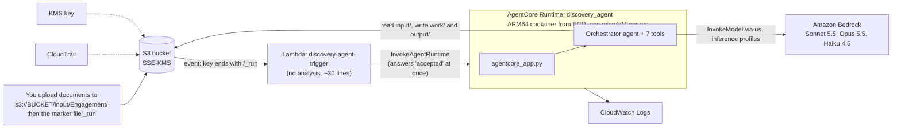

# Deploying the Discovery Agent on AWS (AgentCore Runtime)
> **Superseded (deployment).** Deployment is now one script: see `../deployment/README.md` (`deployment/scripts/deploy.sh` + `deployment/template.yaml`). The manual CLI/console steps, IAM JSON files, `settings.py` constants and file paths below describe the earlier layout and are kept for reference only. The agent now reads its configuration from environment variables set by the template.


> **Configuration changed: no environment variables.** The agent no longer reads any environment variable. All settings
> (profile, region, model ids, limits, storage) are fixed in `discovery_agent/settings.py`. Where this document tells you to
> set `DISCOVERY_BUCKET`, `DISCOVERY_KMS_KEY_ID`, `DISCOVERY_LOCAL_ROOT`, `AWS_PROFILE_NAME`, `AWS_REGION`, any `*_MODEL_ID`,
> `BEDROCK_READ_TIMEOUT`, `MAX_OUTPUT_TOKENS` or `CORPUS_TOKEN_BUDGET`, **ignore it** and edit `settings.py` instead.
> `S3_BUCKET` and `S3_KMS_KEY_ID` are already set there (copied from `build/runtime_env.json`; existence not verified). The
> runtime uses S3 automatically (no local AWS profile); a development machine uses `samples/_store`. Rebuild the package/image
> after any change to `settings.py`: older artifacts under `build/` still carry the previous environment-variable setup.

Step-by-step instructions, the resources to create, and the S3 layout. Written for **us-east-1**, one container on **Amazon Bedrock AgentCore Runtime**, triggered by an S3 upload.

> **Nothing here has been deployed.** No AWS resource was created while preparing this guide.
>
> **What is verified and what is not** (details in section 10)
> - **Verified against AWS documentation:** container contract (ARM64, port 8080, `/invocations`, `/ping`), the execution-role trust policy and baseline permissions, `create_agent_runtime` and `invoke_agent_runtime` parameters, the 15-minute idle timeout, the 8-hour asynchronous limit, the 15-minute synchronous request limit, the 33-character minimum session id, the 2 GB image limit, and the Terraform resource name.
> - **Verified by running it locally:** the AgentCore SDK entrypoint (immediate answer, `/ping` goes `Healthy` then `HealthyBusy`, clean failure and status file), and the whole orchestrator pipeline against Bedrock.
> - **Not verified:** the Docker build, the S3-to-Lambda trigger, the S3/KMS parts of the IAM policy (my addition), and a full run inside the deployed runtime.

---

## 1. What gets deployed



A run takes roughly 15 to 30 minutes. That is why the runtime (not a Lambda) does the work: a Lambda stops at 15 minutes, while an AgentCore asynchronous job may run up to 8 hours.

---

## 2. Resources to create

| # | Resource | Name (suggested) | Purpose |
|---|---|---|---|
| 1 | KMS key (customer managed) + alias | `alias/discovery-agent` | Encrypts everything in the bucket |
| 2 | S3 bucket | `discovery-agent-<ACCOUNT_ID>-us-east-1` | Input documents, checkpoints, outputs |
| 3 | ECR repository | `discovery-agent` | Holds the ARM64 container image |
| 4 | IAM role (runtime execution) | `DiscoveryAgentRuntimeRole` | What the running agent is allowed to do |
| 5 | AgentCore Runtime | `discovery_agent` | Hosts the container (underscores, as in AWS examples) |
| 6 | IAM role (trigger Lambda) | `DiscoveryAgentTriggerRole` | Lets the Lambda start a run |
| 7 | Lambda function | `discovery-agent-trigger` | Starts a run when `_run` is uploaded |
| 8 | S3 event notification | on `input/` + suffix `_run` | Connects the upload to the Lambda |
| 9 | CloudWatch log groups + retention | runtime group is created by AgentCore; `/aws/lambda/discovery-agent-trigger` | Logs (they contain no document text) |
| 10 | CloudTrail trail with S3 data events | existing org trail if you have one | Audit |
| 11 | Bedrock model access | Sonnet 5.5, Opus 5.5, Haiku 4.5 (`us.` inference profiles) | Already usable in this account with the `agentic_systems` profile |

---

## 3. S3 layout (single bucket)

```text
s3://discovery-agent-<ACCOUNT_ID>-us-east-1/
├── input/<Engagement>/                       YOU upload here
│   ├── 01_sep_3                              one object per document, any of: (no extension) .txt .md .eml .docx .pdf
│   ├── 02_sep_15                             ORDER = file name order. Number them oldest to newest.
│   ├── ...
│   └── _run                                  empty marker file: uploading it starts the run
├── work/<Engagement>/<run_id>/               written by the agent (checkpoints). Contains full document text.
│   ├── load_documents.json  extract_explicit_needs.json  find_hidden_signals.json
│   ├── merge_and_rank.json  write_narrative.json  render_outputs.json  publish_outputs.json
│   └── files/                                the rendered files before publishing
└── output/<Engagement>/<run_id>/             READ results here
    ├── status.json                           run state, step timings, error (poll this)
    ├── discovery.json                        validated report, for other agents
    ├── README.md                             the standard discovery document
    ├── discovery_report.docx                 converted from the README
    └── narrative.json                        Haiku summaries (only when produced)
```

Rules enforced by the code:
- `<Engagement>` may contain letters, digits, space, `.`, `_`, `-` (it must start with a letter or digit). The agent rejects anything else.
- Files starting with `_` or `.` and other file types (images, etc.) are ignored. File names must be unique within an engagement.
- Total input is limited to about 150,000 estimated tokens (about 520 KB of text). Above that the agent trims small talk with Haiku; if still too large the run stops with a clear error and no model cost.
- `run_id` is a UTC timestamp such as `2026-10-08T10-30-00Z`, created by the trigger Lambda.

**Recommended bucket settings**
- Block all public access; versioning on; default encryption SSE-KMS with the key above (bucket key enabled).
- Deny non-TLS requests (bucket policy in step 2).
- Lifecycle: expire `work/` after 14 days (it holds full transcripts), and abort incomplete multipart uploads after 7 days. Decide a retention period for `input/` and `output/` with your data-protection owner.

---

## 4. IAM

### 4.1 Runtime execution role: trust policy (from the AWS docs)

```json
{
  "Version": "2012-10-17",
  "Statement": [{
    "Sid": "AssumeRolePolicy",
    "Effect": "Allow",
    "Principal": { "Service": "bedrock-agentcore.amazonaws.com" },
    "Action": "sts:AssumeRole",
    "Condition": {
      "StringEquals": { "aws:SourceAccount": "<ACCOUNT_ID>" },
      "ArnLike": { "aws:SourceArn": "arn:aws:bedrock-agentcore:us-east-1:<ACCOUNT_ID>:*" }
    }
  }]
}
```

### 4.2 Runtime execution role: permissions

The first six statements are the baseline from the AWS documentation (with `agentName` = `discovery_agent`). The last two (S3 and KMS) are **my addition for this project and are untested**.

```json
{
  "Version": "2012-10-17",
  "Statement": [
    { "Sid": "ECRImageAccess", "Effect": "Allow",
      "Action": ["ecr:BatchGetImage", "ecr:GetDownloadUrlForLayer"],
      "Resource": "arn:aws:ecr:us-east-1:<ACCOUNT_ID>:repository/discovery-agent" },
    { "Sid": "ECRToken", "Effect": "Allow", "Action": "ecr:GetAuthorizationToken", "Resource": "*" },
    { "Sid": "Logs", "Effect": "Allow",
      "Action": ["logs:CreateLogGroup", "logs:DescribeLogStreams", "logs:CreateLogStream", "logs:PutLogEvents"],
      "Resource": "arn:aws:logs:us-east-1:<ACCOUNT_ID>:log-group:/aws/bedrock-agentcore/runtimes/*" },
    { "Sid": "LogsDescribe", "Effect": "Allow", "Action": "logs:DescribeLogGroups",
      "Resource": "arn:aws:logs:us-east-1:<ACCOUNT_ID>:log-group:*" },
    { "Sid": "XRayAndMetrics", "Effect": "Allow",
      "Action": ["xray:PutTraceSegments", "xray:PutTelemetryRecords", "xray:GetSamplingRules", "xray:GetSamplingTargets"],
      "Resource": "*" },
    { "Sid": "Metrics", "Effect": "Allow", "Action": "cloudwatch:PutMetricData", "Resource": "*",
      "Condition": { "StringEquals": { "cloudwatch:namespace": "bedrock-agentcore" } } },
    { "Sid": "WorkloadIdentity", "Effect": "Allow",
      "Action": ["bedrock-agentcore:GetWorkloadAccessToken", "bedrock-agentcore:GetWorkloadAccessTokenForJWT",
                 "bedrock-agentcore:GetWorkloadAccessTokenForUserId"],
      "Resource": ["arn:aws:bedrock-agentcore:us-east-1:<ACCOUNT_ID>:workload-identity-directory/default",
                   "arn:aws:bedrock-agentcore:us-east-1:<ACCOUNT_ID>:workload-identity-directory/default/workload-identity/discovery_agent-*"] },
    { "Sid": "BedrockModels", "Effect": "Allow",
      "Action": ["bedrock:InvokeModel", "bedrock:InvokeModelWithResponseStream"],
      "Resource": ["arn:aws:bedrock:*::foundation-model/*", "arn:aws:bedrock:us-east-1:<ACCOUNT_ID>:*"] },

    { "Sid": "S3ReadInput", "Effect": "Allow", "Action": "s3:GetObject",
      "Resource": "arn:aws:s3:::<BUCKET>/input/*" },
    { "Sid": "S3WorkAndOutput", "Effect": "Allow", "Action": ["s3:GetObject", "s3:PutObject"],
      "Resource": ["arn:aws:s3:::<BUCKET>/work/*", "arn:aws:s3:::<BUCKET>/output/*"] },
    { "Sid": "S3List", "Effect": "Allow", "Action": "s3:ListBucket", "Resource": "arn:aws:s3:::<BUCKET>" },
    { "Sid": "KmsForBucket", "Effect": "Allow", "Action": ["kms:Decrypt", "kms:GenerateDataKey"],
      "Resource": "<KMS_KEY_ARN>" }
  ]
}
```

Two details that matter:
- **Do not add an `s3:prefix` condition to `s3:ListBucket`.** The agent checks whether a checkpoint exists with a `HeadObject` call. With a prefix condition, a missing key returns 403 instead of 404 and the agent errors.
- **Bedrock statement:** the AWS baseline is broad on purpose (the `us.` inference profiles route across several US regions). After the first successful run you can narrow it to `foundation-model/anthropic.*` and `inference-profile/us.anthropic.*` in this account, then re-test.

### 4.3 Trigger Lambda role

Basic Lambda logging (`AWSLambdaBasicExecutionRole`) plus:

```json
{ "Version": "2012-10-17",
  "Statement": [{ "Effect": "Allow", "Action": "bedrock-agentcore:InvokeAgentRuntime",
                  "Resource": ["arn:aws:bedrock-agentcore:us-east-1:<ACCOUNT_ID>:runtime/<RUNTIME_ID>",
                               "arn:aws:bedrock-agentcore:us-east-1:<ACCOUNT_ID>:runtime/<RUNTIME_ID>/runtime-endpoint/*"] }] }
```
(The resource ARN format for this action is from my reading of the AWS ARN conventions: confirm it on the first test invocation.)

### 4.4 Your own deployment permissions
The person deploying needs: ECR push (`ecr:*` upload actions on the repository), `iam:PassRole` on `DiscoveryAgentRuntimeRole`, `bedrock-agentcore:CreateAgentRuntime`, `GetAgentRuntime`, `UpdateAgentRuntime`, plus S3, KMS, Lambda and IAM permissions for the other resources. The AWS docs list a broad CLI policy meant only for development; write a narrower one for production.

---

## 5. Step-by-step deployment

Set variables once (a new shell needs them again):

```bash
export AWS_PROFILE=agentic_systems          # or your deployment profile (run: aws sso login --profile agentic_systems)
export REGION=us-east-1
export ACCOUNT_ID=$(aws sts get-caller-identity --query Account --output text)
export BUCKET=discovery-agent-$ACCOUNT_ID-$REGION
export REPO=discovery-agent
export IMAGE=$ACCOUNT_ID.dkr.ecr.$REGION.amazonaws.com/$REPO:v1
```

### Step 1. KMS key
```bash
KEY_ID=$(aws kms create-key --description "Discovery agent data" --query KeyMetadata.KeyId --output text)
aws kms create-alias --alias-name alias/discovery-agent --target-key-id $KEY_ID
export KMS_KEY_ARN=$(aws kms describe-key --key-id $KEY_ID --query KeyMetadata.Arn --output text)
aws kms enable-key-rotation --key-id $KEY_ID
```

### Step 2. S3 bucket
```bash
aws s3api create-bucket --bucket $BUCKET --region $REGION          # us-east-1 needs no LocationConstraint
aws s3api put-public-access-block --bucket $BUCKET --public-access-block-configuration \
  BlockPublicAcls=true,IgnorePublicAcls=true,BlockPublicPolicy=true,RestrictPublicBuckets=true
aws s3api put-bucket-versioning --bucket $BUCKET --versioning-configuration Status=Enabled
aws s3api put-bucket-encryption --bucket $BUCKET --server-side-encryption-configuration \
  '{"Rules":[{"ApplyServerSideEncryptionByDefault":{"SSEAlgorithm":"aws:kms","KMSMasterKeyID":"'$KMS_KEY_ARN'"},"BucketKeyEnabled":true}]}'
aws s3api put-bucket-lifecycle-configuration --bucket $BUCKET --lifecycle-configuration '{"Rules":[
  {"ID":"expire-work","Status":"Enabled","Filter":{"Prefix":"work/"},"Expiration":{"Days":14},"NoncurrentVersionExpiration":{"NoncurrentDays":14}},
  {"ID":"abort-multipart","Status":"Enabled","Filter":{"Prefix":""},"AbortIncompleteMultipartUpload":{"DaysAfterInitiation":7}}]}'
aws s3api put-bucket-policy --bucket $BUCKET --policy '{"Version":"2012-10-17","Statement":[
  {"Sid":"DenyInsecureTransport","Effect":"Deny","Principal":"*","Action":"s3:*",
   "Resource":["arn:aws:s3:::'$BUCKET'","arn:aws:s3:::'$BUCKET'/*"],"Condition":{"Bool":{"aws:SecureTransport":"false"}}}]}'
```

### Step 3. Build and push the container (needs Docker running; ARM64)
The repo's `Dockerfile` (`FROM --platform=linux/arm64 python:3.12-slim`) installs the pinned `requirements-runtime.txt` (which now includes `bedrock-agentcore`), copies `discovery_agent/`, `schema/` and `agentcore_app.py`, exposes 8080 and runs `python agentcore_app.py`. `.dockerignore` keeps `samples/` out of the image.

```bash
aws ecr create-repository --repository-name $REPO --region $REGION \
  --image-tag-mutability IMMUTABLE --image-scanning-configuration scanOnPush=true
aws ecr get-login-password --region $REGION | docker login --username AWS --password-stdin $ACCOUNT_ID.dkr.ecr.$REGION.amazonaws.com
docker buildx create --use                       # once
docker buildx build --platform linux/arm64 -t $IMAGE --push .
aws ecr describe-images --repository-name $REPO --region $REGION --query 'imageDetails[].imageTags'
```
Image size must stay under 2 GB. **Untested:** I could not build the image here (the Docker daemon was not running). Expect to fix small things on the first build; run it once locally before pushing:
```bash
docker run --platform linux/arm64 -p 8080:8080 -e DISCOVERY_LOCAL_ROOT=/tmp/store \
  -e AWS_ACCESS_KEY_ID -e AWS_SECRET_ACCESS_KEY -e AWS_SESSION_TOKEN -e AWS_REGION=$REGION $IMAGE
curl http://localhost:8080/ping        # expect {"status":"Healthy",...}
```

### Step 4. Execution role
Save the trust policy (4.1) as `trust.json` and the permissions (4.2, with your values) as `perms.json`.
```bash
aws iam create-role --role-name DiscoveryAgentRuntimeRole --assume-role-policy-document file://trust.json
aws iam put-role-policy --role-name DiscoveryAgentRuntimeRole --policy-name DiscoveryAgentRuntime --policy-document file://perms.json
export ROLE_ARN=arn:aws:iam::$ACCOUNT_ID:role/DiscoveryAgentRuntimeRole
```

### Step 5. Create the runtime (AWS-documented call; environment variables per the Terraform/API reference)
```python
# deploy_runtime.py
import boto3, os
c = boto3.client("bedrock-agentcore-control", region_name=os.environ["REGION"])
r = c.create_agent_runtime(
    agentRuntimeName="discovery_agent",
    agentRuntimeArtifact={"containerConfiguration": {"containerUri": os.environ["IMAGE"]}},
    networkConfiguration={"networkMode": "PUBLIC"},
    roleArn=os.environ["ROLE_ARN"],
    lifecycleConfiguration={"idleRuntimeSessionTimeout": 900, "maxLifetime": 7200},   # 2 h cap per run
    environmentVariables={
        "DISCOVERY_BUCKET": os.environ["BUCKET"],
        "DISCOVERY_KMS_KEY_ID": os.environ["KMS_KEY_ARN"],
        "AWS_REGION": os.environ["REGION"],
    },
)
print(r["agentRuntimeArn"], r["status"])
```
Do **not** set `AWS_PROFILE_NAME` in the runtime: it must use the execution role. Model ids use the code defaults (the `us.` inference profiles). Wait for the status to become `READY`: `c.get_agent_runtime(agentRuntimeId=...)["status"]`. Set `RUNTIME_ARN` and `RUNTIME_ID` from the output.

**Network mode.** `PUBLIC` is simplest. Because the documents are customer-confidential, consider `VPC` mode with VPC endpoints for S3, Bedrock runtime, ECR and CloudWatch Logs. That is more work and cost; decide with your security owner.

### Step 6. Smoke test without the trigger
```bash
aws s3 cp samples/sep_22 s3://$BUCKET/input/Smoke/01_sep_22          # use a small, non-sensitive test document if you can
python - <<'E'
import boto3, json, uuid, os
c = boto3.client("bedrock-agentcore", region_name=os.environ["REGION"])
r = c.invoke_agent_runtime(agentRuntimeArn=os.environ["RUNTIME_ARN"], runtimeSessionId=str(uuid.uuid4()),   # needs 33+ chars: a UUID has 36
    payload=json.dumps({"engagement": "Smoke", "input_prefix": "input/Smoke/", "run_id": "smoke1"}).encode(), qualifier="DEFAULT")
print(r["response"].read().decode())      # {"status": "accepted", "run_id": "smoke1", "status_key": "output/Smoke/smoke1/status.json"}
E
aws s3 cp s3://$BUCKET/output/Smoke/smoke1/status.json -               # repeat until "state" is succeeded or failed
```
Success = `status.json` shows `"state": "succeeded"` and the four output files exist under `output/Smoke/smoke1/`.

### Step 7. Trigger Lambda
`lambda_function.py`:
```python
import datetime, json, os, re, urllib.parse, uuid
import boto3

client = boto3.client("bedrock-agentcore")
RUNTIME_ARN = os.environ["RUNTIME_ARN"]
KEY = re.compile(r"^input/([A-Za-z0-9][A-Za-z0-9._ -]{0,100})/_run$")


def handler(event, context):
    for record in event["Records"]:
        key = urllib.parse.unquote_plus(record["s3"]["object"]["key"])
        match = KEY.match(key)
        if not match:
            continue
        engagement = match.group(1)
        run_id = datetime.datetime.strptime(record["eventTime"][:19], "%Y-%m-%dT%H:%M:%S").strftime("%Y-%m-%dT%H-%M-%SZ")
        payload = {"engagement": engagement, "input_prefix": f"input/{engagement}/", "run_id": run_id}
        session_id = str(uuid.uuid5(uuid.NAMESPACE_URL, f"{engagement}/{run_id}"))   # 36 chars; the same event gives the same session
        resp = client.invoke_agent_runtime(
            agentRuntimeArn=RUNTIME_ARN, runtimeSessionId=session_id,
            payload=json.dumps(payload).encode(), qualifier="DEFAULT",
        )
        print(json.dumps({"engagement": engagement, "run_id": run_id, "session_id": session_id,
                          "answer": resp["response"].read().decode()}))
```
The run id comes from the S3 event time, so a duplicate S3 delivery maps to the same run, and the agent refuses to start a run whose `status.json` already says `running` or `succeeded`.
```bash
zip fn.zip lambda_function.py
aws lambda create-function --function-name discovery-agent-trigger --runtime python3.12 --handler lambda_function.handler \
  --zip-file fileb://fn.zip --timeout 60 --memory-size 128 --role arn:aws:iam::$ACCOUNT_ID:role/DiscoveryAgentTriggerRole \
  --environment "Variables={RUNTIME_ARN=$RUNTIME_ARN}"
aws lambda add-permission --function-name discovery-agent-trigger --statement-id s3invoke --action lambda:InvokeFunction \
  --principal s3.amazonaws.com --source-arn arn:aws:s3:::$BUCKET --source-account $ACCOUNT_ID
aws s3api put-bucket-notification-configuration --bucket $BUCKET --notification-configuration '{"LambdaFunctionConfigurations":[
  {"LambdaFunctionArn":"arn:aws:lambda:'$REGION':'$ACCOUNT_ID':function:discovery-agent-trigger","Events":["s3:ObjectCreated:*"],
   "Filter":{"Key":{"FilterRules":[{"Name":"prefix","Value":"input/"},{"Name":"suffix","Value":"_run"}]}}}]}'
aws logs put-retention-policy --log-group-name /aws/lambda/discovery-agent-trigger --retention-in-days 30
```
Create `DiscoveryAgentTriggerRole` first (trust `lambda.amazonaws.com`, policy 4.3 plus `AWSLambdaBasicExecutionRole`).
**Untested:** the trigger code and the notification were not run.

### Step 8. Audit and monitoring
- **CloudTrail:** make sure a trail records management events and S3 **data events** for the bucket (`aws cloudtrail put-event-selectors`). If your organisation already has an organisation trail, confirm it covers this bucket.
- **Logs:** the runtime writes to `/aws/bedrock-agentcore/runtimes/<runtime-id>-DEFAULT/...`; set retention (`aws logs put-retention-policy`). The agent logs step names, counts, durations and problem kinds, never document text.
- **Tracing:** AgentCore observability needs CloudWatch Transaction Search. Traces can capture prompts and responses, which contain customer content. Leave it off until you have checked what is captured and who can read it.
- **Cost control:** the `maxLifetime` of 2 hours caps a stuck run; add an AWS Budget alert on the account, because the Opus pass is the main cost.

---

## 6. Day-to-day use

1. Upload documents to `input/<Engagement>/` named `01_...`, `02_...` in chronological order.
2. Upload an empty file named `_run` to the same folder: `aws s3api put-object --bucket $BUCKET --key input/<Engagement>/_run`
3. Watch `output/<Engagement>/<run_id>/status.json` (about 15 to 30 minutes).
4. Read `README.md` and `discovery_report.docx` for people; give `discovery.json` to other agents.
5. **Re-run:** upload `_run` again. It creates a new run id.
6. **Resume a failed run** (reuses finished steps, so no repeated model cost): invoke with `"run_id": "<same id>"` and `"options": {"resume": true}`.
7. **Stop a run:** `stop_runtime_session` with the session id that the trigger Lambda logs (`session_id`).
8. **Ship a new version:** build and push a new immutable tag (`:v2`), then `update_agent_runtime` with the new `containerUri` and the same other settings.

---

## 7. Troubleshooting

| Symptom | Likely cause |
|---|---|
| `status.json` shows `ReadTimeoutError` | Bedrock read timeout: raise `BEDROCK_READ_TIMEOUT` (default 900 s) |
| Run vanishes after about 15 minutes | Session went idle: the async-task registration is missing. It is in `agentcore_app.py`; check the container logs |
| `AccessDenied` on `s3:PutObject` or `kms:GenerateDataKey` | Execution role is missing the S3 or KMS statements, or `DISCOVERY_KMS_KEY_ID` is wrong |
| `ClientError 403` on a checkpoint check | `ListBucket` has a prefix condition: remove it |
| `ValidationException ... runtimeSessionId` | Session id shorter than 33 characters: use a UUID |
| "no input documents found" | Wrong prefix, or all files start with `_`/`.` or have an unsupported extension |
| "corpus too large" | More than about 150,000 tokens even after trimming: split the engagement |
| Bedrock `AccessDenied` or model not found | Model access or inference-profile permission: check the Bedrock statement and model access |
| ECR pull failure at runtime creation | Image is not ARM64, or the role cannot read the repository |

---

## 8. Terraform

You chose Terraform. The AWS provider has the resource `aws_bedrockagentcore_agent_runtime` (verified in the provider documentation). Its required arguments are `agent_runtime_name`, `role_arn`, `agent_runtime_artifact { container_configuration { container_uri } }` and `network_configuration { network_mode }`. Optional: `environment_variables`, `lifecycle_configuration { idle_runtime_session_timeout, max_lifetime }`, `protocol_configuration`, `authorizer_configuration`.

```terraform
resource "aws_bedrockagentcore_agent_runtime" "discovery" {
  agent_runtime_name = "discovery_agent"
  role_arn           = aws_iam_role.runtime.arn

  agent_runtime_artifact {
    container_configuration {
      container_uri = "${aws_ecr_repository.agent.repository_url}:v1"
    }
  }

  environment_variables = {
    DISCOVERY_BUCKET     = aws_s3_bucket.data.bucket
    DISCOVERY_KMS_KEY_ID = aws_kms_key.data.arn
    AWS_REGION           = "us-east-1"
  }

  lifecycle_configuration {
    idle_runtime_session_timeout = 900
    max_lifetime                 = 7200
  }

  network_configuration {
    network_mode = "PUBLIC"
  }
}
```
The Terraform for everything else in section 2 is standard (KMS, bucket, ECR, two IAM roles, Lambda, notification, log groups, CloudTrail) and is **not written yet**. I'd write it after you confirm: the account and region, the naming, `PUBLIC` vs `VPC` network mode, whether an organisation CloudTrail already exists, and the retention periods. Confirm the provider version supports this resource before applying (`terraform providers`).

---

## 9. First-deployment checklist

1. Section 5 steps 1 to 5, then the step 6 smoke test with a small document.
2. Open the output `README.md` and `status.json`; confirm four files and `succeeded`.
3. Run the local container once before pushing (step 3).
4. Add the trigger (step 7) and upload a test `_run`; confirm exactly one run starts. Upload it twice; confirm no second run.
5. Check CloudWatch logs for the runtime: no document text.
6. Only then upload real customer documents.

---

## 10. What is still unverified

| Item | Status |
|---|---|
| Docker image build | Not built (Docker daemon not running here). The pinned `requirements-runtime.txt` was resolved for Python 3.10 while the image uses 3.12, so a pin may need adjusting |
| Execution-role S3/KMS statements and the narrower Bedrock scope | My addition; untested |
| Trigger Lambda, S3 notification, and the `InvokeAgentRuntime` resource ARN format | Untested |
| `environmentVariables` parameter name on `create_agent_runtime` | From the Terraform/API reference, not run |
| A full real run inside the deployed runtime | Not done. Locally the full pipeline ran on real documents (about 14.5 minutes, before the latest simplification) |
| Whether `/ping` returns to `Healthy` after a run in the SDK | Not observed; the unit test proves the task is completed in all cases |
| Performance of the simplified analysis core with real prompts | Not measured yet |

Sources: [Get started without the AgentCore CLI](https://docs.aws.amazon.com/bedrock-agentcore/latest/devguide/getting-started-custom.html), [IAM permissions for AgentCore Runtime](https://docs.aws.amazon.com/bedrock-agentcore/latest/devguide/runtime-permissions.html), [Invoke an AgentCore Runtime agent](https://docs.aws.amazon.com/bedrock-agentcore/latest/devguide/runtime-invoke-agent.html), [InvokeAgentRuntime API](https://docs.aws.amazon.com/bedrock-agentcore/latest/APIReference/API_InvokeAgentRuntime.html), [Asynchronous and long-running agents](https://docs.aws.amazon.com/bedrock-agentcore/latest/devguide/runtime-long-run.html), [AgentCore quotas](https://docs.aws.amazon.com/bedrock-agentcore/latest/devguide/bedrock-agentcore-limits.html), [Terraform `aws_bedrockagentcore_agent_runtime`](https://registry.terraform.io/providers/hashicorp/aws/latest/docs/resources/bedrockagentcore_agent_runtime).
