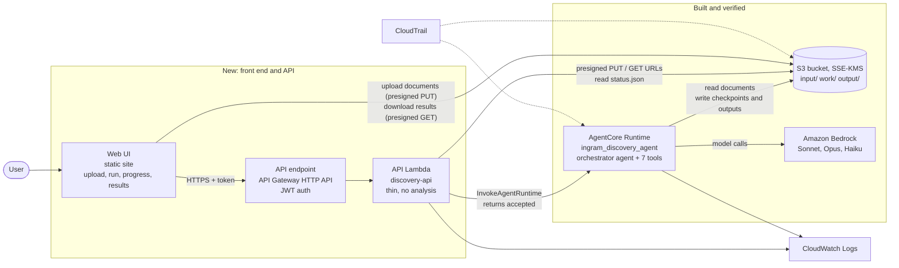
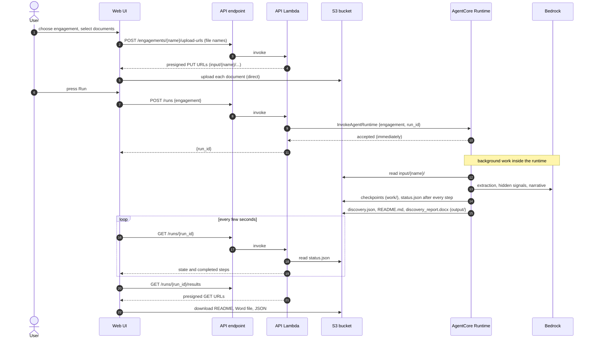

# Discovery Agent: Target Architecture (request-driven, no event triggers)
> **Superseded (built).** The left-hand side (UI, HTTP API, API Lambda) is now built: see `../deployment/README.md` for the routes, DynamoDB run history, cost guards and the one-script deploy. This document is the original design and is kept for reference.


A UI calls an API endpoint. One Lambda starts the agent on AgentCore Runtime. The agent reads documents from S3 and writes its outputs to S3. The UI shows progress and results. There are **no S3 event triggers and no marker files**: every run starts because a person pressed "Run".

> **Status.** The right-hand side (AgentCore Runtime, S3, Bedrock) is **built and verified**: a real cloud run on the Ingram documents and two demo runs on mock data succeeded. The left-hand side (UI, API endpoint, API Lambda) is **not built**; this document is the design for it.

---

## 1. The picture



Two ideas keep it simple:
1. **The Lambda never does the analysis.** It validates, starts the runtime and answers in under a second, so the Lambda 15-minute limit is irrelevant. The runtime works in the background for as long as it needs.
2. **Large files never pass through the API.** The UI uploads straight to S3 with short-lived presigned URLs, because API Gateway and Lambda cap request bodies at 6 to 10 MB.

---

## 2. One run, end to end



---

## 3. The API (four routes, one Lambda)

| Route | Does | Reads or writes |
|---|---|---|
| `POST /engagements/{name}/upload-urls` | Returns one presigned PUT URL per file name (expiry 10 min, key locked to `input/{name}/<file>`) | signs only; touches no data |
| `POST /runs` | Validates the engagement name, builds `run_id` and a session id, calls `InvokeAgentRuntime`, returns `{run_id}` | runtime invoke |
| `GET /runs/{run_id}` | Returns the contents of `output/{name}/{run_id}/status.json` (state, steps, error) | S3 read |
| `GET /runs/{run_id}/results` | Returns presigned GET URLs (expiry 5 min) for the output files once the run has succeeded | signs only |

Rules inside the Lambda:
- The engagement name must match the same pattern the runtime enforces (letters, digits, space, `.`, `_`, `-`), so keys cannot be forged.
- It never logs file names beyond the engagement, and never any document content.
- Starting a run while one is already `running` for the same engagement returns the existing `run_id` (the runtime also guards against a double start).

---

## 4. S3 layout (single bucket, SSE-KMS, versioned)

```text
input/{engagement}/            documents uploaded by the UI (numbered 01_, 02_ ... oldest to newest)
work/{engagement}/{run_id}/    checkpoints written by the runtime (contain full document text)
output/{engagement}/{run_id}/  discovery.json, README.md, discovery_report.docx, narrative.json, status.json
code/                          packaged agent versions (not read by users)
```

---

## 5. Permissions (least privilege)

| Principal | Allowed |
|---|---|
| **API Lambda role** | `bedrock-agentcore:InvokeAgentRuntime` on this one runtime; `s3:GetObject` on `output/*`; `s3:PutObject` on `input/*` (needed to sign uploads); `kms:GenerateDataKey` and `kms:Decrypt` on the bucket key; CloudWatch Logs |
| **Runtime role** (exists) | read `input/*` and `code/*`; read and write `work/*` and `output/*`; list the bucket; the KMS key; Bedrock invoke; logs |
| **Users** | no AWS credentials: they hold only a token for the API and the short-lived presigned URLs |
| **Bucket** | block public access, TLS only, default SSE-KMS, versioning on, lifecycle expiry on `work/` |

---

## 6. What exists and what is new

| Piece | State |
|---|---|
| AgentCore Runtime (version 3), orchestrator, 7 tools, Bedrock stages | **Built, verified in the cloud** |
| S3 bucket, KMS key, runtime IAM role, output layout, `status.json` progress file | **Built, verified** |
| Direct invoke from a terminal (`demo/run_demo.sh`) | **Built, verified** |
| API Lambda (4 routes) | New |
| API endpoint (API Gateway) and authentication | New |
| Web UI | New |
| Lifecycle expiry on `work/`; CORS on the bucket for browser uploads | New |
| Infrastructure as code for all of it | New (nothing is codified today; the runtime was created with CLI calls) |

Obsolete under this design: `scripts/trigger_lambda.py`, the `_run` marker file, and the S3-notification steps in the deployment guides. They can stay unused or be removed later.

---

## 7. Decisions needed before building

| Decision | Options | Recommendation |
|---|---|---|
| Who may use it? | Cognito user pool with a hosted login; your existing SSO / identity provider; a shared internal network only | Cognito, so the API can verify a token without storing secrets |
| Endpoint type | API Gateway HTTP API (JWT authorizer built in) or a Lambda function URL (IAM auth only) | API Gateway HTTP API, because browsers need JWT auth and CORS |
| UI hosting | S3 + CloudFront, or Amplify Hosting | S3 + CloudFront (simple, cheap) |
| Run history | List past runs from S3 prefixes, or keep an index in DynamoDB | S3 prefixes at first; add DynamoDB only if the list gets large |
| Infrastructure as code | Terraform (your earlier choice) | Terraform for the new pieces, then import the existing runtime |

---

## 8. Things to verify when building (not yet checked)

- **IAM resource ARN for `InvokeAgentRuntime`.** Calls from an administrator identity work today. The exact resource format for a least-privilege Lambda policy needs one test.
- **Lambda SDK version.** The `bedrock-agentcore` client needs a recent boto3, newer than the one bundled with Lambda, so it must be packaged with the function.
- **Presigned uploads to a KMS-encrypted bucket.** The signing identity needs KMS permissions; confirm with one real upload from a browser (including CORS).
- **Run concurrency.** Two people starting runs at once will share Bedrock quotas. A per-account rate or a queue may be needed if several people use it together.
- **Telemetry.** The runtime currently runs without OpenTelemetry. If tracing is added, prompt and response capture must be disabled, because they contain customer text.
